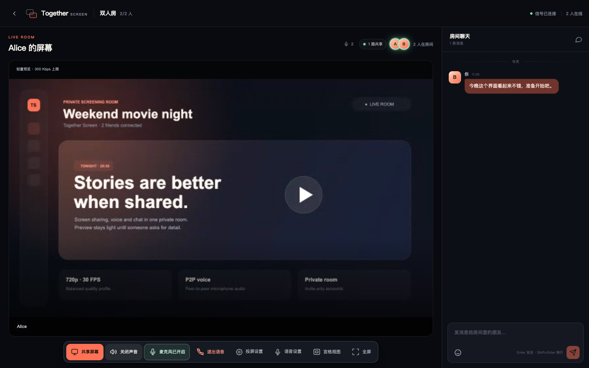
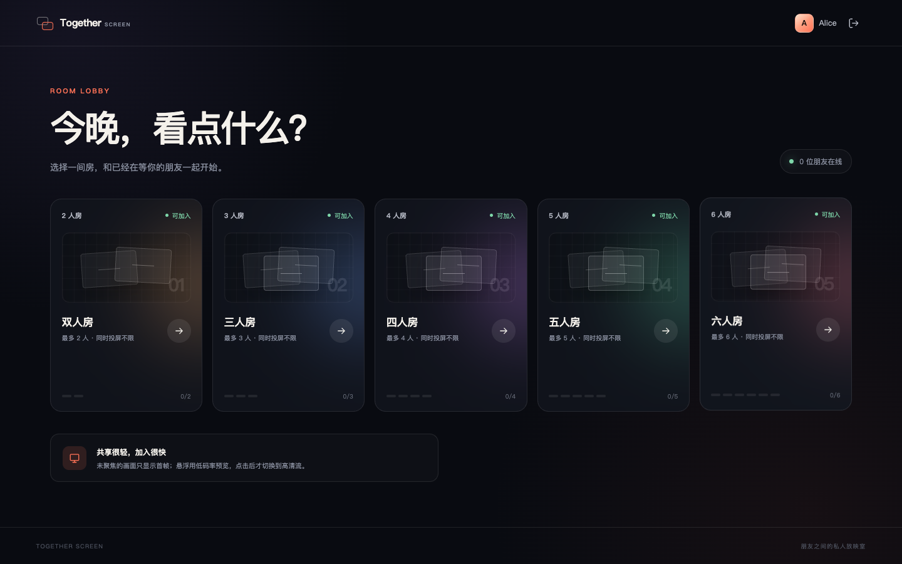
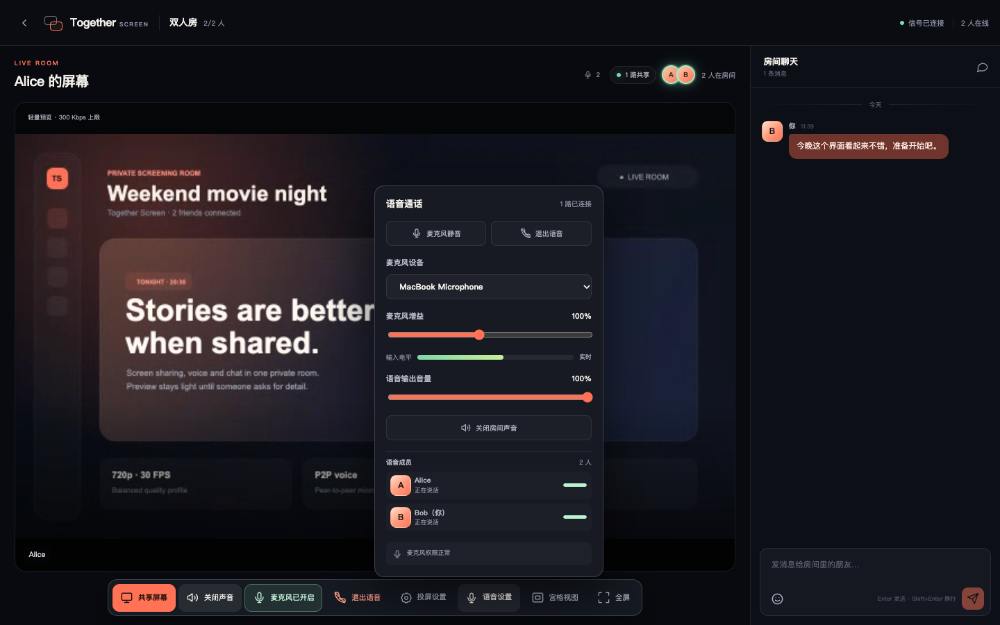
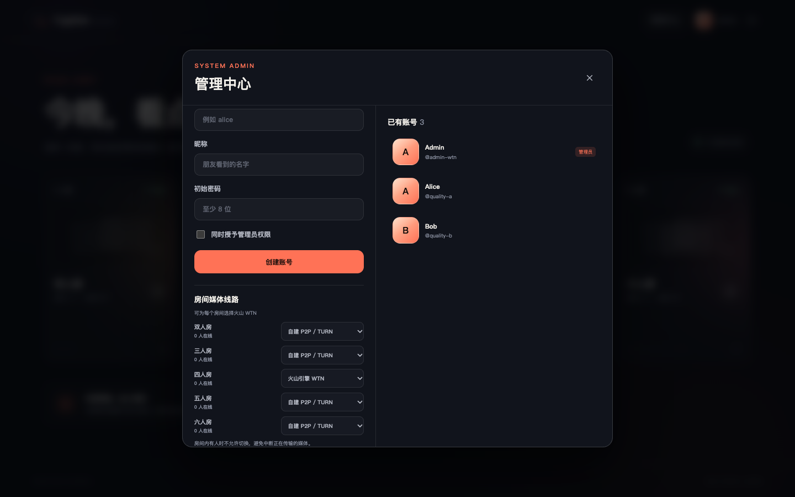
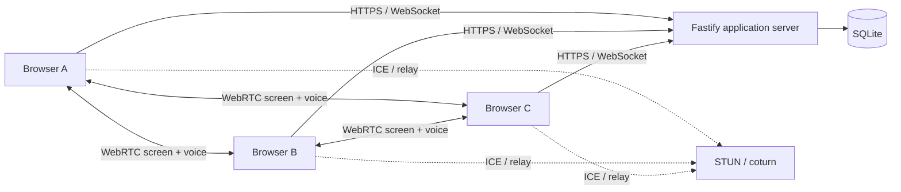

# Together Screen

English | [简体中文](README.zh-CN.md)

Together Screen is a self-hosted WebRTC room for small groups of friends. It combines multi-user screen sharing, peer-to-peer voice chat and persistent text chat in one private room. It is designed for movie nights, watch parties, presentations and lightweight remote collaboration.

The project is currently an **MVP / 0.x** application. Desktop Chrome and Edge are the primary supported browsers. Public registration is intentionally disabled; an administrator creates every account.

## Screenshots



<details>
<summary>View lobby and voice settings</summary>

### Room lobby



### Voice settings



### Admin media routing



</details>

## Features

### Fixed rooms

- One room each for 2, 3, 4, 5 and 6 participants.
- Administrators can select P2P/TURN or Volcengine WTN independently for each room.
- An account can be active in only one room at a time.
- Each user can share one screen at a time.
- Multiple users can share screens simultaneously.

### Screen sharing

- WebRTC peer-to-peer screen sharing; media does not pass through the application server by default.
- Managed Volcengine WTN publishing and subscriptions when enabled for the room.
- Default `720p / 30 FPS / 3 Mbps`.
- Clarity, Balanced, Motion and Data Saver presets.
- Lightweight poster by default, about 300 Kbps preview on hover, and HD only after a click.
- The sharer confirms that sender encoding changes were applied before the viewer displays “HD”.
- Capture dimensions are constrained to 720p or 1080p according to the selected preset.
- Grid, spotlight, secondary-share strip and fullscreen layouts.
- Remote video stays alive when idle or unfocused and is covered by a poster rather than paused into a black frame.
- Screen audio is supported when the operating system and browser expose it.

### Voice chat

- P2P microphone audio using the same STUN/TURN configuration as screen sharing.
- Volcengine WTN microphone transport for rooms configured to use managed media.
- Join, leave, mute and unmute.
- Microphone device selection and device-change detection.
- Input gain, input level, output volume and speaking indicators.
- Participant connection status and readable permission/device errors.
- Echo cancellation, noise suppression, automatic gain control, mono capture and a 48 kHz ideal sample rate.

### Room chat

- Text messages and Emoji.
- Persistent SQLite history.
- Long-message wrapping, date separators, grouped messages and a “jump to latest” control.
- File, image and attachment upload are not included.

## Technology

| Layer | Technology |
| --- | --- |
| Web client | React 19, TypeScript, Vite |
| Application server | Node.js 22, Fastify, WebSocket |
| Realtime media | WebRTC, STUN, coturn, optional Volcengine WTN |
| Persistence | SQLite |
| Authentication | HttpOnly cookies, scrypt password hashing, expiring TURN credentials |
| Testing | Vitest, TypeScript, Vite |

## Architecture



The application server handles accounts, sessions, room state, signaling and chat. Screen and voice media normally flow directly between browsers. TURN relays media when direct NAT traversal fails.

In a WTN room, each participant publishes separate screen and voice streams to Volcengine and viewers create independent subscriptions. The application server remains the control plane and issues short-lived WTN JWTs without exposing `WTN_APP_KEY` to the browser.

A mesh room can have up to `N × (N - 1)` directional media links. In a six-person room where everyone shares HD video, each sender may need to encode five outgoing streams. This design targets small rooms, not large conferences.

See [Architecture](docs/ARCHITECTURE.md) for signaling, quality negotiation, voice lifecycle and scalability details.

## Requirements

- Node.js `22.13` or newer
- npm
- Desktop Chrome or Edge
- HTTPS/WSS in production
- coturn for users behind restrictive NAT or corporate networks

## Local development

```bash
git clone <your-repository-url>
cd together-screen
cp .env.example .env
npm install
```

Create the first administrator:

```bash
npm run user:add -- \
  --username admin \
  --display Admin \
  --password "at-least-8-characters" \
  --admin
```

Start the development environment:

```bash
npm run dev
```

Open `http://localhost:5173`.

- Vite: `http://localhost:5173`
- Fastify: `http://localhost:3000`
- Vite proxies `/api` and `/ws`.

Administrators can create more accounts in the “Account Management” dialog or use the CLI:

```bash
npm run user:add -- --username alice --display Alice --password "at-least-8-characters"
npm run user:list
```

## Usage

1. The administrator creates accounts and shares credentials with friends.
2. Each participant signs in with their own account.
3. The administrator selects P2P/TURN or Volcengine WTN for each empty room in “Admin Center”.
4. Everyone enters the same capacity-matched room.
5. Click “Share Screen” and select a window, tab or display.
6. Other participants see the poster first. Hover for a lightweight preview and click for HD.
7. Click “Join Voice” and allow microphone access.
8. Open “Voice Settings” to select a microphone, adjust gain, change output volume or inspect connection state.
9. Use the right sidebar for text and Emoji chat.

Only one browser client can be active for an account. Signing in from a new browser or tab invalidates the previous active page.

## Quality modes

| State | Defaults | Behavior |
| --- | --- | --- |
| Poster | JPEG first frame | Shown while idle; the media track remains alive |
| Preview | About 300 Kbps, 15 FPS, about 360p | Shown on hover |
| HD | 720p, 30 FPS, up to 3 Mbps | Shown after click and sender confirmation |
| Clarity | 1080p, 30 FPS, up to 5 Mbps | Text, code and static detail |
| Motion | 720p, 60 FPS, up to 5 Mbps | Games and fast movement |
| Data Saver | 720p, 30 FPS, up to 1.8 Mbps | Constrained networks |

Bitrate values are caps. Encoder behavior, content movement and congestion control determine actual usage.

## Configuration

```bash
cp .env.example .env
```

| Variable | Default | Description |
| --- | --- | --- |
| `PORT` | `3000` | Application port |
| `HOST` | `0.0.0.0` | Listen address |
| `APP_ORIGIN` | Local development origins | Allowed WebSocket origins, comma-separated |
| `DATA_DIR` | `./data` | SQLite persistence directory |
| `SESSION_DAYS` | `30` | Login-session lifetime |
| `COOKIE_SECURE` | `true` in production | Restrict cookies to HTTPS |
| `TRUST_PROXY` | `false` | Trust reverse-proxy forwarding headers |
| `STUN_URLS` | Google / Cloudflare | STUN URLs, comma-separated |
| `TURN_URLS` | Empty | TURN URLs, including optional UDP/TCP/TLS |
| `TURN_USERNAME` | Empty | Static TURN username for testing |
| `TURN_CREDENTIAL` | Empty | Static TURN password |
| `TURN_SECRET` | Empty | coturn shared secret; recommended |
| `TURN_CREDENTIAL_TTL_SECONDS` | `3600` | Lifetime of generated TURN credentials |
| `WTN_APP_ID` | Empty | Volcengine WTN application ID |
| `WTN_APP_KEY` | Empty | Server-only WTN JWT signing key |
| `WTN_BUSINESS_ID` | Empty | Optional WTN business ID |
| `WTN_API_BASE_URL` | Volcengine endpoint | WTN WHIP/WHEP API base |
| `WTN_TOKEN_TTL_SECONDS` | `600` | Lifetime of generated WTN JWTs |

When a shared secret is configured, the server generates expiring per-user TURN credentials. Keep the real secret in a protected environment file only.

## Production build

```bash
npm ci
npm run build
npm start
```

Build output:

- `dist/web`: frontend assets
- `dist/backend`: Fastify server

Production requirements:

1. HTTPS/WSS.
2. Exact `APP_ORIGIN`.
3. `COOKIE_SECURE=true`.
4. Persistent `DATA_DIR`.
5. WebSocket Upgrade support in the reverse proxy.
6. Reachable TURN for restrictive networks.
7. Volcengine `WTN_APP_ID` and `WTN_APP_KEY` if any room uses WTN.

See [Deployment](docs/DEPLOYMENT.md) for Nginx, systemd, coturn, Docker and Baota/aaPanel instructions.

## Docker

```bash
export APP_ORIGIN=http://localhost:3000
export COOKIE_SECURE=false
export WTN_APP_ID=""
export WTN_APP_KEY=""
docker compose up -d --build
```

Create the administrator:

```bash
docker compose exec app npm run user:add:prod -- \
  --username admin \
  --display Admin \
  --password "at-least-8-characters" \
  --admin
```

Use HTTPS and `COOKIE_SECURE=true` for a public deployment.

## Data and backup

```text
data/
├── app.sqlite
├── app.sqlite-shm
└── app.sqlite-wal
```

Stop the service before copying the directory, or use a SQLite-aware backup that includes WAL state.

## Security

- Use a strong unique administrator password.
- Never commit `.env`, SQLite files, WebRTC dumps, real IP addresses or TURN secrets.
- Never expose or commit `WTN_APP_KEY`; browsers receive only short-lived JWTs.
- Rotate a TURN secret immediately if it entered a public repository or diagnostic file.
- Redact accounts, IPs and network metadata before posting WebRTC diagnostics.
- Report vulnerabilities privately according to [SECURITY.md](SECURITY.md).

## Testing

```bash
npm run check
```

This runs TypeScript checking, Vitest and a production build. Current tests cover password hashing, sessions, SQLite messages, room capacity, single-share semantics, voice signaling and quality confirmation.

## Project structure

```text
src/
├── server/       Fastify API, WebSocket, rooms, auth and SQLite
├── shared/       Shared protocol types
└── web/          React UI, WebRTC state and styles
docs/             Architecture, deployment and troubleshooting
.github/          CI, issue templates and PR template
```

## Known limitations

- Designed for fixed rooms of up to six people.
- Mobile browsers are suitable for viewing and chat, not primary screen sharing.
- Safari and Firefox differ in screen and system-audio support.
- No file/image transfer, message recall, audit log, user deletion UI or online-kick UI yet.
- P2P and TURN quality depends on participant networks, carrier routing and server egress.
- WTN rooms require a Volcengine account, AppID/AppKey and accepted WTN billing terms.

See [Troubleshooting](docs/TROUBLESHOOTING.md) for common failures.

## Contributing

- [Contributing](CONTRIBUTING.md)
- [Code of Conduct](CODE_OF_CONDUCT.md)
- [Security Policy](SECURITY.md)
- [GitHub Publishing Checklist](docs/PUBLISHING.md)

## License

[MIT](LICENSE)
