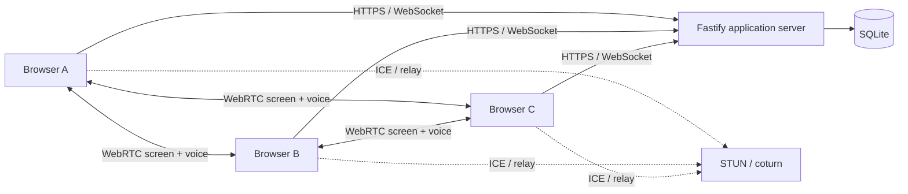

# Together Screen

English | [简体中文](README.zh-CN.md)

Together Screen is a self-hosted room for small groups of friends. It combines multi-user screen sharing, independent voice chat and persistent text chat in one private room, with self-hosted P2P/TURN, Volcengine RTC and Volcengine WTN media transports.

The project is currently an **MVP / 0.x** application. Desktop Chrome and Edge are the primary supported browsers. Public registration is intentionally disabled; an administrator creates every account.

## Screenshots


<details>
<summary>View lobby and voice settings</summary>

### Room lobby


### Voice settings


### Admin media routing


</details>

## Features

### Fixed rooms

- Administrators can select P2P/TURN, Volcengine RTC or Volcengine WTN independently for each room.
- Ten identical rooms are available, each with a capacity of 10 participants and no tier restrictions.
- An account can be active in only one room at a time.
- Each user can share one screen at a time.
- Multiple users can share screens simultaneously.

### Screen sharing

- WebRTC peer-to-peer screen sharing; media does not pass through the application server by default.
- Volcengine RTC rooms publish a 360p video-only preview plus the selected-quality main screen stream.
- Managed Volcengine WTN publishing and subscriptions when enabled for the room.
- Default Standard: `1080p / 15 FPS / 2.5 Mbps`.
- Users select a use case instead of arbitrarily combining resolution and frame rate.
- Every remote share starts its lightweight live preview automatically after entry, without hover or click.
- The latest decoded frame is a transition fallback only and never freezes a healthy preview.
- P2P confirms sender encoding changes; RTC and WTN switch to an independently published main screen stream.
- RTC viewers subscribe to shared system audio only after focusing the HD stream; preview never carries system audio.
- Every room can select 360p, 720p, 1080p, 2K/1440p and 4K/2160p standard profiles.
- WTN republishes the selected standard profile while WebRTC congestion control adapts actual send bitrate.
- Grid, spotlight, secondary-share strip and fullscreen layouts.
- Switching tiles or returning from HD keeps the latest frame visible during negotiation, then resumes the lightweight live preview.
- Screen system audio is off by default and must be enabled by the sharer before sharing starts.

### Rooms

The lobby provides “Room 1” through “Room 10”, each with a fixed capacity of 10 participants. All rooms share the same quality profiles. An administrator may independently choose self-hosted P2P/TURN, Volcengine RTC or Volcengine WTN for each empty room.

### Voice chat

- P2P microphone audio using the same STUN/TURN configuration as screen sharing.
- Volcengine WTN microphone transport for rooms configured to use managed media.
- Volcengine RTC microphone transport on an independent stream; screen quality changes do not reconnect voice.
- Join, leave, mute and unmute.
- Microphone device selection and device-change detection.
- Input gain, input level, output volume and speaking indicators.
- Participant connection status and readable permission/device errors.
- Echo cancellation, noise suppression, automatic gain control, mono capture and a 48 kHz ideal sample rate.
- Opus preference, an approximately 48 Kbps voice cap and elevated real-time network priority.
- Automatic fallback to the system default microphone if the active input disconnects.
- Microphone mute affects only the sender's voice, not shared screen audio; room output mute remains independent.

### Room chat

- Text messages and Emoji.
- Persistent SQLite history.
- Long-message wrapping, date separators, grouped messages and a “jump to latest” control.
- File, image and attachment upload are not included.

## Technology

| Layer | Technology |
| --- | --- |
| Web client | React 19, TypeScript, Vite |
| Application server | Node.js 22, Fastify, WebSocket |
| Realtime media | WebRTC, STUN, coturn, optional Volcengine RTC / WTN |
| Persistence | SQLite |
| Authentication | HttpOnly cookies, scrypt password hashing, expiring TURN credentials |
| Testing | Vitest, TypeScript, Vite |

## Architecture



The application server handles accounts, sessions, room state, signaling and chat. Screen and voice media normally flow directly between browsers. TURN relays media when direct NAT traversal fails.

In a WTN room, each participant publishes separate screen-preview, screen-HD and voice streams to Volcengine, and viewers create subscriptions on demand. The dual-stream design does not depend on WTN simulcast RIDs and adds roughly 300 Kbps to a screen sharer's upload. The application server remains the control plane and issues short-lived WTN JWTs without exposing `WTN_APP_KEY` to the browser.

In a RTC room, microphone voice is published independently from screen media. A sharer publishes a 360p video-only preview identity and a main screen identity at the selected profile. Viewers subscribe to the preview automatically, then subscribe to the main screen and shared system audio only after clicking the tile. The server issues short-lived room tokens and never sends `RTC_APP_KEY` to the browser.

Only P2P rooms use a mesh of up to `N × (N - 1)` directional media links. A ten-person room can therefore reach 90 directional links, and each sharer may need to encode several outgoing streams. RTC or WTN is recommended when many participants share simultaneously; P2P/TURN is better for a smaller number of active sharers.

See [Architecture](docs/ARCHITECTURE.md) for signaling, quality negotiation, voice lifecycle and scalability details.

See [Media transport guide](docs/MEDIA_TRANSPORTS.md) for cost, deployment and room-mode selection guidance.

See [Screen-sharing parameter reference](docs/SCREEN_SHARING_BENCHMARK.md) for publicly documented parameters from mainstream collaboration products.

## Requirements

- Node.js `22.13` or newer
- npm
- Desktop Chrome or Edge
- HTTPS/WSS in production
- coturn for users behind restrictive NAT or corporate networks

## Local development

```bash
git clone <your-repository-url>
cd together-screen
cp .env.example .env
npm install
```

Create the first administrator:

```bash
npm run user:add -- \
  --username admin \
  --display Admin \
  --password "at-least-8-characters" \
  --admin
```

Start the development environment:

```bash
npm run dev
```

Open `http://localhost:5173`.

- Vite: `http://localhost:5173`
- Fastify: `http://localhost:3000`
- Vite proxies `/api` and `/ws`.

Administrators can create more accounts in the “Account Management” dialog or use the CLI:

```bash
npm run user:add -- --username alice --display Alice --password "at-least-8-characters"
npm run user:list
```

## Usage

1. The administrator creates accounts and shares credentials with friends.
2. Each participant signs in with their own account.
3. The administrator selects P2P/TURN, Volcengine RTC or Volcengine WTN for each empty room in “Admin Center”.
4. Everyone enters the agreed room.
5. To share media audio, open “Share Settings” and explicitly enable shared system audio before sharing.
6. Click “Share Screen” and select a window, tab or display.
7. Other participants see the lightweight live preview automatically; click the tile for HD.
8. Click “Join Voice” and allow microphone access.
9. Open “Voice Settings” to select a microphone, adjust gain, change output volume or inspect connection state.
10. Use the right sidebar for text and Emoji chat.

Only one browser client can be active for an account. Signing in from a new browser or tab invalidates the previous active page.

## Quality modes

| State | Defaults | Behavior |
| --- | --- | --- |
| Preview | RTC/WTN: about 300 Kbps, 15 FPS, 360p; P2P: low-priority small layer | Starts automatically and resumes after leaving HD |
| Latest frame | Last decoded frame | Used only during connect, switch or reconnect fallback |
| Lite | 360p, 15 FPS, 0.8 Mbps | Lowest-bandwidth viewing |
| Smooth | 720p, 10 FPS, 1.5 Mbps | Chat, basic browsing and constrained networks |
| Standard | 1080p, 15 FPS, 2.5 Mbps | Default: office, web, documents and code |
| HD | 1080p, 30 FPS, 4 Mbps | Software demos, animation and video |
| Ultra | 2K/1440p, 30 FPS, 8 Mbps | High-resolution desktops and detailed content |
| Gaming | 1080p, 60 FPS, 8 Mbps | Games and motion; frame rate first |
| 4K | 4K/2160p, 30 FPS, 20 Mbps | Requires a 4K source, browser encoding support and sufficient upload |

Bitrate values are caps. WebRTC congestion control still adapts actual bitrate from packet loss, RTT and available bandwidth. Normal rooms clamp higher modes to their allowed resolution and bitrate instead of producing invalid combinations.

With RTC/WTN, 4K still depends on a 4K capture source, browser encoding support and viewer decoding capability. In P2P rooms, 2K/4K significantly increases sharer upload; reserve the highest modes for the content that needs them.

## Configuration

```bash
cp .env.example .env
```

| Variable | Default | Description |
| --- | --- | --- |
| `PORT` | `3000` | Application port |
| `HOST` | `0.0.0.0` | Listen address |
| `APP_ORIGIN` | Local development origins | Allowed WebSocket origins, comma-separated |
| `DATA_DIR` | `./data` | SQLite persistence directory |
| `SESSION_DAYS` | `30` | Login-session lifetime |
| `COOKIE_SECURE` | `true` in production | Restrict cookies to HTTPS |
| `TRUST_PROXY` | `false` | Trust reverse-proxy forwarding headers |
| `STUN_URLS` | Google / Cloudflare | STUN URLs, comma-separated |
| `TURN_URLS` | Empty | TURN URLs, including optional UDP/TCP/TLS |
| `TURN_USERNAME` | Empty | Static TURN username for testing |
| `TURN_CREDENTIAL` | Empty | Static TURN password |
| `TURN_SECRET` | Empty | coturn shared secret; recommended |
| `TURN_CREDENTIAL_TTL_SECONDS` | `3600` | Lifetime of generated TURN credentials |
| `WTN_APP_ID` | Empty | Volcengine WTN application ID |
| `WTN_APP_KEY` | Empty | Server-only WTN JWT signing key |
| `WTN_BUSINESS_ID` | Empty | Optional WTN business ID |
| `WTN_API_BASE_URL` | Volcengine endpoint | WTN WHIP/WHEP API base |
| `WTN_TOKEN_TTL_SECONDS` | `600` | Lifetime of generated WTN JWTs |
| `RTC_APP_ID` | Empty | Volcengine RTC application ID |
| `RTC_APP_KEY` | Empty | Server-only RTC token signing key |
| `RTC_BUSINESS_ID` | Empty | Optional RTC business ID |
| `RTC_TOKEN_TTL_SECONDS` | `7200` | Lifetime of generated RTC room tokens |

When a shared secret is configured, the server generates expiring per-user TURN credentials. Keep the real secret in a protected environment file only.

## Production build

```bash
npm ci
npm run build
npm start
```

Build output:

- `dist/web`: frontend assets
- `dist/backend`: Fastify server

Production requirements:

1. HTTPS/WSS.
2. Exact `APP_ORIGIN`.
3. `COOKIE_SECURE=true`.
4. Persistent `DATA_DIR`.
5. WebSocket Upgrade support in the reverse proxy.
6. Reachable TURN for restrictive networks.
7. Volcengine `WTN_APP_ID` and `WTN_APP_KEY` if any room uses WTN.
8. Volcengine `RTC_APP_ID` and `RTC_APP_KEY` if any room uses RTC.

See [Deployment](docs/DEPLOYMENT.md) for Nginx, systemd, coturn, Docker and Baota/aaPanel instructions.

## Docker

```bash
export APP_ORIGIN=http://localhost:3000
export COOKIE_SECURE=false
export WTN_APP_ID=""
export WTN_APP_KEY=""
export RTC_APP_ID=""
export RTC_APP_KEY=""
export RTC_BUSINESS_ID=""
docker compose up -d --build
```

Create the administrator:

```bash
docker compose exec app npm run user:add:prod -- \
  --username admin \
  --display Admin \
  --password "at-least-8-characters" \
  --admin
```

Use HTTPS and `COOKIE_SECURE=true` for a public deployment.

## Data and backup

```text
data/
├── app.sqlite
├── app.sqlite-shm
└── app.sqlite-wal
```

Stop the service before copying the directory, or use a SQLite-aware backup that includes WAL state.

## Security

- Use a strong unique administrator password.
- Never commit `.env`, SQLite files, WebRTC dumps, real IP addresses or TURN secrets.
- Never expose or commit `WTN_APP_KEY` or `RTC_APP_KEY`; browsers receive only short-lived tokens.
- Rotate a TURN secret immediately if it entered a public repository or diagnostic file.
- Redact accounts, IPs and network metadata before posting WebRTC diagnostics.
- Report vulnerabilities privately according to [SECURITY.md](SECURITY.md).

## Testing

```bash
npm run check
```

This runs TypeScript checking, Vitest and a production build. Current tests cover password hashing, sessions, SQLite messages, room capacity, single-share semantics, voice signaling and quality confirmation.

## Project structure

```text
src/
├── server/       Fastify API, WebSocket, rooms, auth and SQLite
├── shared/       Shared protocol types
└── web/          React UI, WebRTC state and styles
docs/             Architecture, deployment and troubleshooting
.github/          CI, issue templates and PR template
```

## Known limitations

- Designed for ten fixed rooms of up to ten people; simultaneous P2P HD sharing has significant client and upload costs.
- Mobile browsers are suitable for viewing and chat, not primary screen sharing.
- Safari and Firefox differ in screen and system-audio support.
- Shared system audio is selected before screen capture starts; changing it while sharing requires stopping and restarting the share.
- No file/image transfer, message recall, audit log, user deletion UI or online-kick UI yet.
- P2P and TURN quality depends on participant networks, carrier routing and server egress.
- RTC/WTN rooms require a Volcengine account, the matching AppID/AppKey and accepted billing terms.

See [Troubleshooting](docs/TROUBLESHOOTING.md) for common failures.

## Contributing

- [Contributing](CONTRIBUTING.md)
- [Code of Conduct](CODE_OF_CONDUCT.md)
- [Security Policy](SECURITY.md)
- [GitHub Publishing Checklist](docs/PUBLISHING.md)

## License

[MIT](LICENSE)
