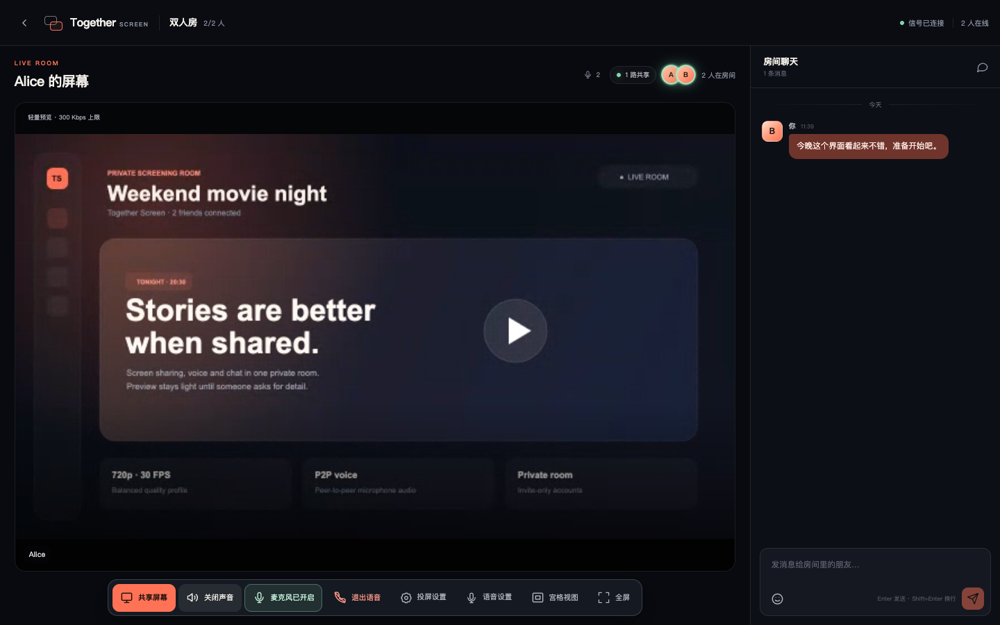
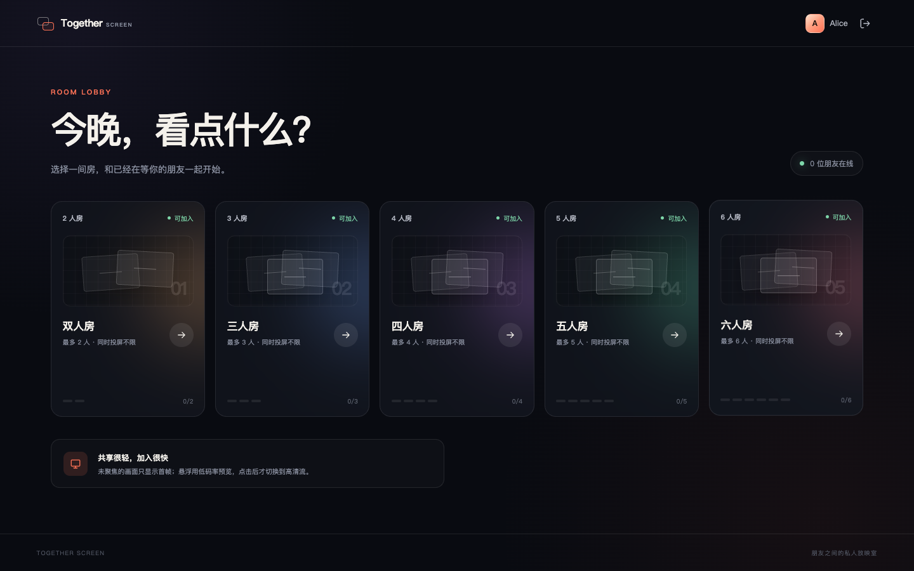
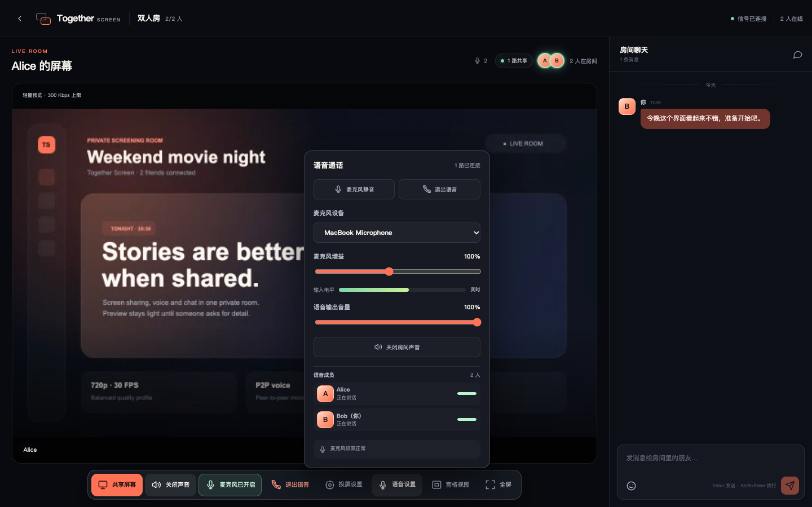
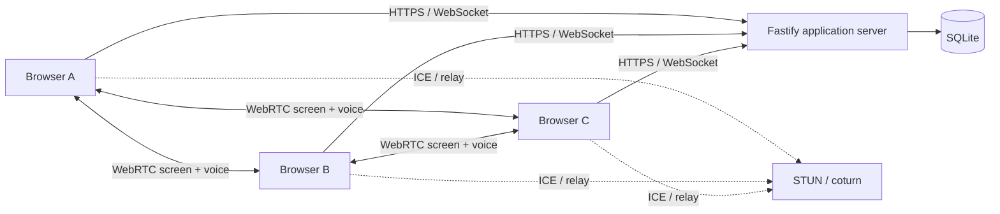

# Together Screen

[English](README.md) | 简体中文

Together Screen 是一个面向朋友小群体的自托管 WebRTC 投屏房间。它把屏幕共享、在线语音和文字聊天放在同一个私密房间里，适合一起看视频、看比赛、演示操作或远程协作。

项目当前处于 **MVP / 0.x** 阶段，优先支持桌面版 Chrome 和 Edge。账号由管理员创建，不开放公开注册。

## 界面预览



<details>
<summary>查看大厅与语音设置截图</summary>

### 房间大厅



### 语音设置



</details>

## 核心特性

### 固定房间

- 双人房、三人房、四人房、五人房、六人房各一个。
- 一个账号同一时间只能在一个房间。
- 每位用户同一时间只能共享一块屏幕。
- 同一房间允许多人同时投屏，不限制同时共享的人数。

### 屏幕共享

- WebRTC 点对点屏幕共享，业务服务器不转发媒体流。
- 默认 `720p / 30 FPS / 3 Mbps`。
- 支持清晰优先、平衡、流畅优先和省带宽预设。
- 默认只显示轻量首帧，鼠标悬浮时播放约 300 Kbps 低码率预览。
- 点击画面后才请求高清，并由共享端确认参数实际生效。
- 720p 和 1080p 同时约束采集分辨率，避免高分辨率配低码率。
- 宫格视图、焦点视图、其他共享缩略条和全屏模式。
- 鼠标离开、切换窗口或浏览器失焦时，以首帧覆盖画面，不会暂停媒体轨导致黑屏。
- 支持屏幕系统声音；实际能力取决于操作系统和浏览器。

### 在线语音

- P2P 麦克风语音，复用屏幕共享的 STUN/TURN 配置。
- 加入、退出、静音和取消静音。
- 麦克风设备选择与热插拔检测。
- 麦克风输入增益、输入电平和语音输出音量。
- 本地和远端说话高亮。
- 语音成员列表和连接状态。
- 回声消除、降噪、自动增益和单声道 48 kHz 采集。
- 权限拒绝、设备占用、设备断开等可读错误提示。

### 房间聊天

- 文字聊天和 Emoji。
- 聊天历史持久化到 SQLite。
- 长文本换行、日期分组、连续消息分组和回到最新消息。
- 不提供文件、图片或附件传输。

## 技术栈

| 层 | 技术 |
| --- | --- |
| Web 前端 | React 19、TypeScript、Vite |
| 业务服务 | Node.js 22、Fastify、WebSocket |
| 实时媒体 | WebRTC、STUN、coturn |
| 数据存储 | SQLite |
| 身份认证 | HttpOnly Cookie、scrypt 密码哈希、限时 TURN 凭证 |
| 测试与构建 | Vitest、TypeScript、Vite |

## 架构



业务服务器负责账号、会话、房间状态、WebRTC 信令和聊天。媒体默认在浏览器之间直连；当 NAT 无法打洞时，由 TURN 中继。

网状连接的数量约为 `N × (N - 1)`。六人房内所有人都高清共享时，每位用户最多需要向另外五人编码发送画面。因此当前设计适合最多六人的小房间，而不是大型会议。

更详细的连接、信令和画质协商说明见 [架构设计](docs/ARCHITECTURE.zh-CN.md)。

## 环境要求

- Node.js `22.13` 或更高版本
- npm
- 桌面版 Chrome 或 Edge
- 生产环境必须具备 HTTPS/WSS
- 跨严格 NAT 使用时建议部署 coturn

## 本地开发

```bash
git clone <your-repository-url>
cd together-screen
cp .env.example .env
npm install
```

创建第一个管理员：

```bash
npm run user:add -- \
  --username admin \
  --display Admin \
  --password "至少8位密码" \
  --admin
```

启动开发环境：

```bash
npm run dev
```

打开 `http://localhost:5173`。

- Vite 前端：`http://localhost:5173`
- Fastify 业务服务：`http://localhost:3000`
- Vite 已代理 `/api` 和 `/ws`

管理员登录后可以在“账户管理”界面创建更多账号，也可以使用 CLI：

```bash
npm run user:add -- --username alice --display Alice --password "至少8位密码"
npm run user:list
```

## 使用说明

1. 管理员创建账号并把账号密码发给朋友。
2. 每位朋友使用自己的账号登录。
3. 所有人进入同一个人数匹配的房间。
4. 点击底部“共享屏幕”，选择浏览器窗口、标签页或完整屏幕。
5. 其他成员默认看到首帧；悬浮查看轻量预览，点击切换高清。
6. 点击底部“加入语音”并允许麦克风权限。
7. 通过“语音设置”选择麦克风、调整增益、输出音量或查看连接状态。
8. 使用右侧聊天栏发送文字或 Emoji。

同一账号只允许一个活跃页面。在新设备或新标签页登录会注销旧页面，这是为了避免重复身份和信令冲突。

## 屏幕画质

| 状态 | 默认参数 | 行为 |
| --- | --- | --- |
| 首帧 | JPEG 首帧 | 未悬浮时显示，媒体流仍保持播放 |
| 轻量预览 | 约 300 Kbps、15 FPS、约 360p | 鼠标悬浮时显示 |
| 高清 | 720p、30 FPS、最高 3 Mbps | 点击并收到共享端确认后显示 |
| 清晰优先 | 1080p、30 FPS、最高 5 Mbps | 适合文字、代码和静态内容 |
| 流畅优先 | 720p、60 FPS、最高 5 Mbps | 适合游戏和快速运动画面 |
| 省带宽 | 720p、30 FPS、最高 1.8 Mbps | 适合网络较差时 |

码率是上限，不代表始终消耗该带宽。静态桌面、浏览器拥塞控制和画面变化都会影响实际码率。

## 配置

复制示例文件：

```bash
cp .env.example .env
```

| 变量 | 默认值 | 说明 |
| --- | --- | --- |
| `PORT` | `3000` | 业务服务端口 |
| `HOST` | `0.0.0.0` | 业务服务监听地址 |
| `APP_ORIGIN` | 本地开发地址 | 允许连接 WebSocket 的前端 Origin，多个值用逗号分隔 |
| `DATA_DIR` | `./data` | SQLite 持久化目录 |
| `SESSION_DAYS` | `30` | 登录会话有效天数 |
| `COOKIE_SECURE` | 生产模式默认 `true` | 是否只通过 HTTPS 发送登录 Cookie |
| `TRUST_PROXY` | `false` | 是否信任反向代理的转发头 |
| `STUN_URLS` | Google / Cloudflare | 公共 STUN 地址，多个值用逗号分隔 |
| `TURN_URLS` | 空 | TURN 地址，可同时配置 UDP、TCP 或 TLS |
| `TURN_USERNAME` | 空 | 静态 TURN 用户名，仅用于简单测试 |
| `TURN_CREDENTIAL` | 空 | 静态 TURN 密码 |
| `TURN_SECRET` | 空 | coturn 共享密钥，推荐使用 |
| `TURN_CREDENTIAL_TTL_SECONDS` | `3600` | 动态 TURN 凭证有效期 |

使用共享密钥时，业务服务会为每个登录用户生成带过期时间的 TURN 用户名和 HMAC 凭证。真实密钥只能保存在服务器环境变量或权限受限的 `.env` 中，禁止提交到 Git。

## 生产构建

```bash
npm ci
npm run build
npm start
```

构建结果：

- `dist/web`：前端静态文件
- `dist/backend`：Fastify 业务服务

生产环境至少需要：

1. 使用 HTTPS/WSS。
2. 正确设置 `APP_ORIGIN`。
3. 设置 `COOKIE_SECURE=true`。
4. 使用持久化 `DATA_DIR`。
5. 反向代理支持 WebSocket Upgrade。
6. 严格 NAT 用户需要可用的 TURN。

完整的 Nginx、systemd、宝塔和 coturn 配置见 [部署指南](docs/DEPLOYMENT.zh-CN.md)。

## Docker

先准备环境变量：

```bash
export APP_ORIGIN=http://localhost:3000
export COOKIE_SECURE=false
docker compose up -d --build
```

创建管理员：

```bash
docker compose exec app npm run user:add:prod -- \
  --username admin \
  --display Admin \
  --password "至少8位密码" \
  --admin
```

正式部署时由反向代理提供 HTTPS，并设置 `COOKIE_SECURE=true`。

## 数据与备份

默认数据目录：

```text
data/
├── app.sqlite
├── app.sqlite-shm
└── app.sqlite-wal
```

备份时应停止服务后复制整个目录，或使用能够保证 SQLite 和 WAL 一致性的备份方式。

## 安全说明

- 项目不开放公开注册，但生产部署仍应使用强管理员密码。
- 不要提交 `.env`、数据库、WebRTC dump、真实 IP 或 TURN 密钥。
- 如果 TURN 密钥曾经进入公开仓库，应立即轮换并清理 Git 历史。
- WebRTC 诊断文件可能包含 IP、候选地址和网络统计，分享前务必脱敏。
- 安全问题请不要创建公开 Issue，具体流程见 [安全策略](SECURITY.zh-CN.md)。

## 测试与质量检查

```bash
npm run check
```

该命令依次执行：

1. TypeScript 类型检查
2. Vitest 自动测试
3. 生产构建

当前测试覆盖密码哈希、账号与会话、SQLite 消息、固定房间容量、单用户单共享、语音信令和画质确认。

## 项目结构

```text
src/
├── server/       Fastify API、WebSocket、房间、认证和 SQLite
├── shared/       前后端共享类型
└── web/          React 界面、WebRTC 状态和样式
docs/             架构、部署与排障文档
.github/          CI、Issue 和 PR 模板
```

## 已知边界

- 当前面向最多六人的固定房间，不适合大规模会议。
- 手机端可观看，但不建议作为主要共享端。
- Safari 和 Firefox 的屏幕共享、系统声音能力存在平台差异。
- 浏览器无法保证所有系统都能采集完整系统声音。
- 当前没有消息撤回、图片/文件传输、审计日志、用户删除和在线踢人界面。
- P2P 和 TURN 的实际质量取决于双方网络、运营商和服务器带宽。

更多问题排查见 [故障排查](docs/TROUBLESHOOTING.zh-CN.md)。

## 参与贡献

欢迎提交 Bug、功能建议和 Pull Request。开始前请阅读：

- [贡献指南](CONTRIBUTING.zh-CN.md)
- [行为准则](CODE_OF_CONDUCT.zh-CN.md)
- [安全策略](SECURITY.zh-CN.md)
- [GitHub 发布检查清单](docs/PUBLISHING.zh-CN.md)

## License

[MIT](LICENSE)
